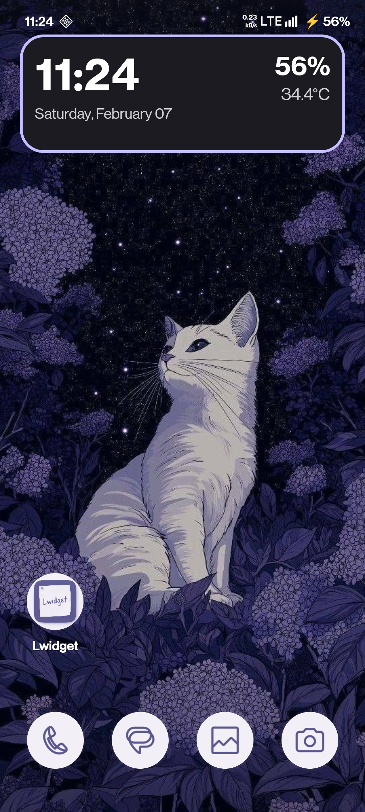
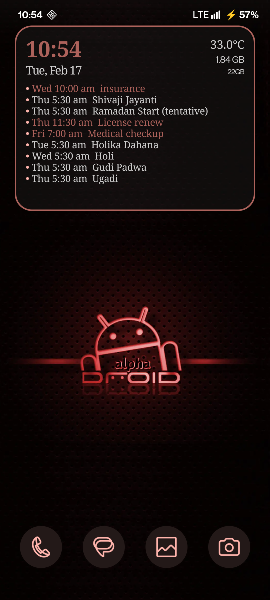
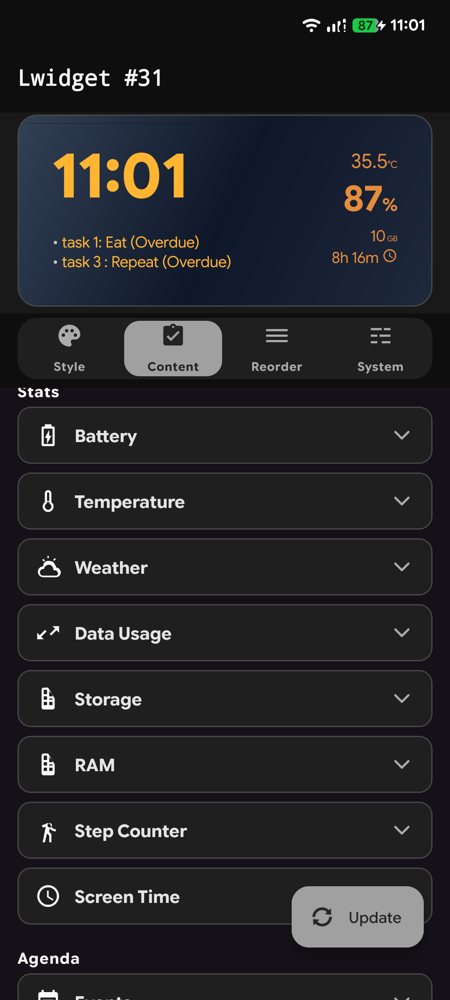
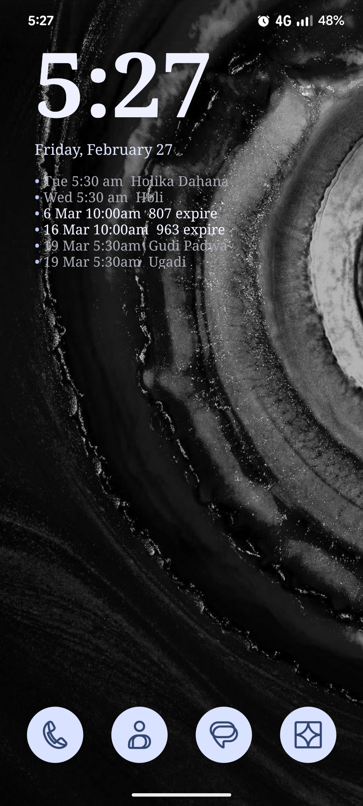
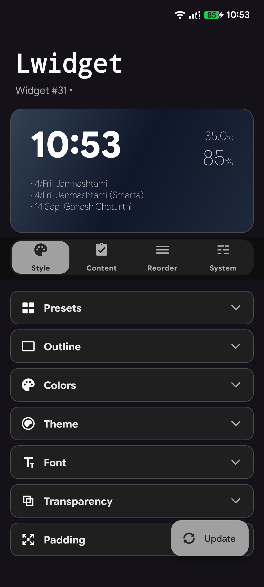

# Lwidget

<picture>
  <source media="(prefers-color-scheme: dark)" srcset="docs/images/banner_dark.svg">
  <source media="(prefers-color-scheme: light)" srcset="docs/images/banner_light.svg">
  
</picture>

**A modern, open-source Android widget built with Material 3 design principles.** 
Essential information at a glance with dynamic color. Completely private with no internet permission.

[Download](#download) • [Features](#features) • [Setup](#setup) • [More LeanBitLab apps](#more-leanbitlab-apps) • [Support](#support)

<table>
  <tr>
    <td></td>
    <td></td>
    <td></td>
    <td></td>
    <td></td>
  </tr>
</table>

## Why Lwidget

- **Private by design**: no internet permission is required or requested, so your data never leaves your device.
- **At-a-glance information**: monitor time, date, battery, internal storage, RAM, screen time and daily data usage in one widget.
- **Health and tasks**: track daily steps with an optional counter and display upcoming calendar events and [Tasks.org](https://tasks.org/) tasks.
- **Offline weather integration**: view current conditions and weekly forecast warnings via [Breezy Weather](https://github.com/breezy-weather/breezy-weather) without network or location access.
- **Deep styling**: adapt to system colors with Material You, choose from 11 fonts, drag to reorder elements, and adjust transparency, padding and borders.

## Download

<table border="0">
  <tr>
    <td align="center"></td>
    <td align="center"></td>
  </tr>
</table>

## Features

| Area | Highlights |
| :--- | :--- |
| **Clock & time** | Clear time and date display, custom formats, world clock, next scheduled alarm |
| **Device status** | Battery percentage and temperature, available internal storage, available RAM |
| **Digital wellbeing** | Daily screen time tracking, daily data consumption monitoring |
| **Health & tasks** | Step counter with daily goal tracking, upcoming calendar events, [Tasks.org](https://tasks.org/) task integration |
| **Weather** | Current conditions and weekly forecast warnings via [Breezy Weather](https://github.com/breezy-weather/breezy-weather) integration |
| **Appearance** | Material You dynamic colors, custom text and background colors, light and dark mode, manual transparency |
| **Layout & styling** | Drag to reorder items, custom widget padding, outline borders and colors, 11 font styles (Default, Serif, Monospace, Cursive, Condensed, and more) |
| **System** | Configurable widget refresh interval, refined settings interface, zero internet permission |

## Setup

Permissions and integrations are requested only when you enable the corresponding feature.

| Item | Adds | Requirement |
| :--- | :--- | :--- |
| **Calendar** | Upcoming agenda events | Calendar permission |
| **Step Counter** | Daily step count display | Activity Recognition and Notifications permissions |
| **Usage stats** | Screen time and daily data usage | Usage Access permission |
| **Tasks.org** | Task integration | [Tasks.org](https://tasks.org/) installed |
| **Weather** | Current conditions and forecasts | [Breezy Weather](https://github.com/breezy-weather/breezy-weather) integration |

<b>Integration and background update setup</b>

- **Breezy Weather**: install [Breezy Weather](https://github.com/breezy-weather/breezy-weather) with DataBridge enabled. In Breezy Weather, open **Settings → External Modules → Send Gadgetbridge Data** and toggle on Lwidget. Lwidget reads weather data stored locally without accessing location or the internet.
- **Battery optimization**: Lwidget runs without background services, but aggressive system battery savers may delay widget refreshes. To keep updates regular, disable battery optimization for Lwidget in device settings, or enable the Step Counter, whose lightweight foreground service keeps all widget features updating live.

## More LeanBitLab apps

| App | What it is |
| :--- | :--- |
| [LeanType](https://github.com/LeanBitLab/LeanType) | Private, smart and customizable keyboard with AI, voice and offline options |
| [LtvLauncher](https://github.com/leanbitlab-org/LtvLauncher) | Fast, private and ad-free launcher for Android TV |
| [RdTube](https://github.com/LeanBitLab/RdTube) | Private, fast video client for Reddit |

See [all LeanBitLab projects](https://github.com/LeanBitLab#-android-apps).

## Community

[Issues](https://github.com/LeanBitLab/Lwidget/issues) • [Discussions](https://github.com/LeanBitLab/Lwidget/discussions) • [Telegram](https://t.me/leanbitlab)

## Support

Lwidget is community-funded. If it helps you stay organized every day, consider backing the project on [GitHub Sponsors](https://github.com/sponsors/LeanBitLab) or [Open Collective](https://opencollective.com/leanbitlab-org).

## Credits and license

Built by [LeanBitLab](https://github.com/LeanBitLab).

Licensed under [GPL-3.0](LICENSE).
